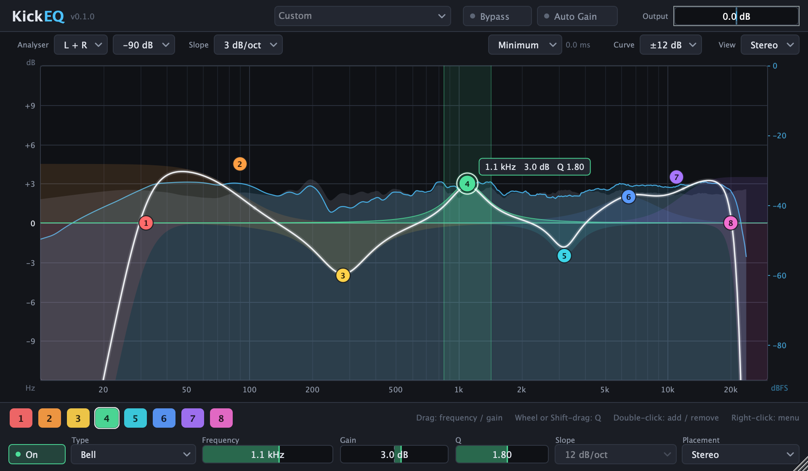
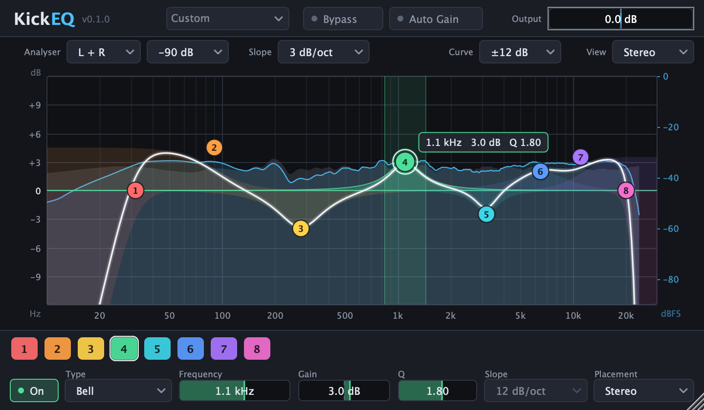

# KickEQ

An 8-band parametric equaliser with a live spectrum analyser, built as **VST3** and **CLAP** for the desktop (JUCE
editor) and as a headless **native CLAP** shell for the Akai MPC, the Kick mobile app and static linking. All
shells run the same portable DSP core, so they render bit-identical audio for the same state.



> Version 0.2.0. CI (GitHub Actions, `.github/workflows/ci.yml`) builds and tests core + native CLAP on Linux x86_64
> (also with ASan/UBSan) and AArch64, macOS arm64 and Windows x64; cross-builds ARMv7 hard-float (Akai MPC) and
> AArch64 and runs the tests under qemu-user; builds static libraries for iOS (device + simulator) and Android
> (arm64-v8a, armeabi-v7a); builds the JUCE VST3 + CLAP on four desktop platforms and runs pluginval
> (strictness 5; no Linux AArch64 pluginval asset exists, so not there) and clap-validator 0.4.1.
> **Not done:** any test inside a DAW, mouse interaction of the editor on real hardware, CPU measurement on the MPC
> ([docs/MPC-BENCH-REQUEST.md](docs/MPC-BENCH-REQUEST.md)), linear phase on the ARMv7 build (off by default there).

## Features

- **8 bands**, each with: on / off, type (Bell, Low Shelf, High Shelf, Low Cut, High Cut, Notch, Band Pass),
  frequency 10 Hz .. 30 kHz, gain +-24 dB, Q 0.1 .. 18, slope for the cuts (6, 12, 18, 24, 36, 48 dB/oct) and
  **placement**: Stereo, Left, Right, Mid or Side (mid/side processing per band)
- Output gain +-24 dB, **auto gain** (pink-noise weighted loudness compensation), bypass (20 ms cross-fade)
- 10 factory presets (Flat, Kick Punch, Sub Clean, Vocal Presence, Air, Telephone, Mid Scoop, Bass Boost, De-Mud,
  Mastering Tilt); in the JUCE shell they are the plugin's programs
- RBJ biquads with exactly pre-warped centre frequency, double precision, Butterworth cascades for the cuts;
  parameter changes are smoothed over 30 ms (coefficients recomputed every 32 samples while something moves);
  block-size independent, no allocation or locks on the audio thread, mono and stereo
- **Linear-phase mode** (optional, parameter `phase_mode`: Minimum / Linear 2048 / 4096 / 8192): the same EQ as a
  symmetric FIR (partitioned FFT convolution, kernels designed on a low-priority thread), latency exactly N / 2 samples
  (21 / 43 / 85 ms at 48 kHz), reported to the host; not automatable (a change asks the host to restart the plugin);
  built with `KICKEQ_LINEAR_PHASE` (default ON, OFF for the MPC / ARMv7 toolchain until it is benchmarked there)
- **Spectrum analyser** (4096-point FFT, pre and post, source L+R / Mid / Side) drawn by the editor

### Editor (JUCE shell)

Resizable (720 x 420 minimum, 960 x 560 default), HiDPI, dark theme, software rendered (no OpenGL, no web view).

- The canvas shows the analyser (pre in grey, post as line and fill, range -60 / -90 / -120 dB, slope
  compensation 0 / 3 / 4.5 dB/oct), the EQ curve (range +-6 / 12 / 24 / 30 dB, channel view Stereo / L / R / M / S)
  and a translucent fill per band
- One coloured node per enabled band: **drag** = frequency and gain, **mouse wheel** or **Shift-drag** = Q,
  **double-click** on empty canvas adds the first disabled band, double-click on a node or **Delete** disables it,
  **right-click** = type / slope / placement menu; hovering a node highlights the frequency range the band acts on
- Bottom strip: band chips plus the controls of the selected band; header: preset menu, bypass, auto gain, output
  gain; toolbar: the Phase box (Minimum / Linear 2048 / 4096 / 8192) with the latency in ms. Every edit goes through JUCE parameter attachments, so a DAW records automation touch / release correctly
- Analyser source / range, slope compensation and curve range are editor state, saved in the `UI01` chunk of the
  plugin state (not automatable parameters)



## Formats and targets

| Target | What | Output (after build) |
|--------|------|----------------------|
| `KickEQ_VST3` | JUCE shell, VST3 with editor | `build/KickEQ_artefacts/Release/VST3/KickEQ.vst3` |
| `KickEQ_CLAP` | the same JUCE processor and editor through [clap-juce-extensions](https://github.com/free-audio/clap-juce-extensions) (`clap.gui`) | `build/KickEQ_artefacts/Release/CLAP/KickEQ.clap` |
| `KickEQNative` | native CLAP shell: no GUI toolkit, depends only on the CLAP headers; vendor extension for drawing the analyser in another UI | `build/native/KickEQ-native.clap` |
| `kickeq_clap_native` | the same shell as a static library (`kickeq_get_plugin_factory()`), for the MPC, the mobile app and static loaders | `libkickeq_clap_native.a` |
| `kickeq_core` | the DSP core: parameter table, engine, response curve, analyser, state blob, presets (C++17, no dependencies) | `libkickeq_core.a` |

VST3 category `Fx|EQ`; CLAP id `com.safian.kickeq`, features `audio-effect`, `equalizer`, `stereo`. The JUCE CLAP
and the native CLAP share the id, so install only one of them on a machine; both read and write the same state
blob. Host automation ids differ between them (JUCE derives them from the string ids), so exchange projects as
state, not as automation lanes. See [docs/ARCHITECTURE.md](docs/ARCHITECTURE.md) section 2.1.

## Repository layout

```
core/       kickeq_core + unit tests (own minimal runner)
clap/       native CLAP shell (static library + KickEQ-native.clap)
juce/       JUCE shell: processor, generic parameters from the core table, editor
tools/      clap_testhost (conformance host), kickeq_bench, kickeq_editor_snapshot, kickeq_juce_shell_test
cmake/toolchains/   ARMv7 Linux, AArch64 Linux, Android, iOS toolchain files
manifest/   plugin manifest template     scripts/   build.sh, package.sh, make_manifest.py
docs/       ARCHITECTURE.md, docs/img/ (editor screenshots)
```

## Building

Requirements: CMake >= 3.22, a C++17 compiler, git, and internet access on the first configure when the JUCE shell
is built (JUCE, clap-juce-extensions and the CLAP headers are fetched with `FetchContent` at pinned versions, see
[THIRD_PARTY.md](THIRD_PARTY.md)). Ninja is used when installed.

```sh
scripts/build.sh            # Release build into ./build (JUCE VST3 + CLAP, native CLAP, tools, tests)
scripts/build.sh --clean    # from scratch
scripts/build.sh --debug
```

or by hand:

```sh
cmake -S . -B build -G Ninja -DCMAKE_BUILD_TYPE=Release
cmake --build build --parallel
```

| Option | Default | Meaning |
|--------|---------|---------|
| `KICKEQ_BUILD_JUCE` | ON | JUCE shell (VST3 + CLAP with editor). `OFF` needs only CMake and a C++17 compiler: core, native CLAP, tools and tests |
| `KICKEQ_BUILD_CLAP_NATIVE` | ON | native CLAP shell |
| `KICKEQ_BUILD_TOOLS` | ON | `clap_testhost`, `kickeq_bench` (needs the native shell) |
| `KICKEQ_BUILD_TESTS` | ON | register the tests with CTest |
| `KICKEQ_BUILD_EDITOR_SNAPSHOT` | ON (OFF on Linux) | `kickeq_editor_snapshot`, the offscreen editor renderer (JUCE on Linux wants a display) |
| `KICKEQ_LINEAR_PHASE` | ON (OFF with the ARMv7 toolchain file) | linear-phase mode: `phase_mode` parameter, FFT convolver, design thread. OFF removes it from the engine; the parameter stays in the table, hidden and read-only |
| `KICKEQ_SANITIZE` | OFF | AddressSanitizer + UndefinedBehaviorSanitizer for the core and its tests |
| `KICKEQ_CODESIGN_IDENTITY` | `-` | macOS: codesign identity of the bundles (`-` = ad hoc) |

macOS: the build targets the host architecture (arm64 on Apple Silicon), deployment target 11.0; add
`-DCMAKE_OSX_ARCHITECTURES="arm64;x86_64"` for a universal binary. The bundles are re-signed as the last build
step; check them with `codesign --verify --deep --strict <bundle>`. The `-G Xcode` generator has not been verified.

Core, native shell, tools and tests only (no JUCE, nothing downloaded except the CLAP headers):

```sh
cmake -S . -B build-core -DKICKEQ_BUILD_JUCE=OFF && cmake --build build-core && ctest --test-dir build-core
```

Cross toolchain files for the MPC (ARMv7 NEON hard-float), AArch64, Android and iOS are in `cmake/toolchains/`
(`-DCMAKE_TOOLCHAIN_FILE=...`, with `-DKICKEQ_BUILD_JUCE=OFF`).

Linux packages for the JUCE shell (Debian / Ubuntu):

```sh
sudo apt-get install ninja-build pkg-config libasound2-dev libx11-dev libxcomposite-dev \
  libxcursor-dev libxext-dev libxinerama-dev libxrandr-dev libxrender-dev libfreetype-dev \
  libfontconfig1-dev libgl1-mesa-dev
```

Windows (Visual Studio 2022): `cmake -S . -B build -A x64` and `cmake --build build --config Release --parallel`.

## Tests

```sh
ctest --test-dir build --output-on-failure      # everything (add -C Release with multi-config generators)
ctest --test-dir build -R cross_shell           # bit-exactness JUCE shell vs native shell
```

| Test | What |
|------|------|
| `kickeq_core_tests` | unit tests of the core (filter responses, null test, extremes, block-size independence, smoothing, M/S, auto gain, FFT, analyser, state fuzzing, presets) |
| `clap_testhost_static`, `clap_testhost_dynamic` | CLAP conformance of the native shell (static factory and `dlopen`) against the core engine, bit-exact |
| `kickeq_linear_alloc_test`, `kickeq_linear_thread_test` | linear phase: no heap allocation on the audio side (global `operator new` counting, through mode switches and kernel hand-overs); mailbox / seqlock / engine stress with real threads (run it under ThreadSanitizer too: `-DCMAKE_CXX_FLAGS=-fsanitize=thread`) |
| `kickeq_bench_check` | CPU benchmark regression guard (the linear-phase scenarios are reported only) |
| `clap_testhost_juce` | the same conformance suite against the JUCE CLAP (`--juce` profile: the places where the wrapper legitimately differs are listed at the top of `tools/clap_testhost/conformance.cpp`) |
| `cross_shell_*` | the fixed baseline state and 5 s of noise at 44.1 and 48 kHz through both CLAPs must be **bit-identical**; a state blob saved by one shell loads into the other with bit-identical parameter values |
| `kickeq_juce_shell_test` | the JUCE processor directly: parameters from the core table, bus layouts (stereo, mono), mono audio, programs, state and `UI01` chunk, host notification, analyser hook |
| `editor_snapshot_smoke` | renders the editor offscreen and checks the images |

pluginval (not part of CTest): `pluginval --strictness-level 5 --validate build/KickEQ_artefacts/Release/VST3/KickEQ.vst3`.

### Editor snapshots

```sh
build/kickeq_editor_snapshot_artefacts/Release/kickeq_editor_snapshot docs/img      # editor-default.png, editor-small.png
build/kickeq_editor_snapshot_artefacts/Release/kickeq_editor_snapshot out --ms --hover 5 --prefix ms
```

The tool instantiates processor and editor without a window, loads an 8-band setting, pushes one second of pink-ish
noise through `processBlock` for the analyser and writes PNGs with `createComponentSnapshot`.

## Installing

Copy the bundles to the usual plugin folders:

| OS | VST3 | CLAP |
|----|------|------|
| macOS | `~/Library/Audio/Plug-Ins/VST3/` | `~/Library/Audio/Plug-Ins/CLAP/` |
| Linux | `~/.vst3/` | `~/.clap/` |
| Windows | `C:\Program Files\Common Files\VST3\` | `C:\Program Files\Common Files\CLAP\` |

`scripts/package.sh` bundles the native CLAP, the JUCE VST3 / CLAP, the manifest and the licence files per platform.

## Continuous integration

`.github/workflows/ci.yml` builds and tests the core on Linux x86_64 / AArch64, macOS and Windows (sanitizers on
Linux), cross-builds ARMv7 and AArch64 and runs the tests under qemu-user, checks the iOS and Android static
libraries, builds the desktop plugins and runs pluginval and clap-validator on them, and packages releases.
**The workflow has not been run on GitHub yet.**

## License

Copyright (C) 2026 Safian Szabolcs.

This program is free software: you can redistribute it and/or modify it under the terms of the
**GNU Affero General Public License, version 3 or (at your option) any later version**
(`AGPL-3.0-or-later`, see [LICENSE](LICENSE)).

- **JUCE** is used under its **AGPLv3** option (JUCE is dual-licensed AGPLv3 / commercial). Because
  the JUCE shell links JUCE, the combined work is distributed under the AGPL: anyone who receives the
  binaries (or interacts with them over a network) must be able to get the corresponding source code.
- **clap-juce-extensions**, the CLAP SDK (`clap`, `clap-helpers`) and the bundled Steinberg VST3 SDK 3.8.0 are
  **MIT** licensed and compatible with the AGPL. The core and the native CLAP shell contain no third-party code;
  the native shell only includes the CLAP headers.

Versions and licences of all dependencies: [THIRD_PARTY.md](THIRD_PARTY.md), [NOTICE](NOTICE).

VST is a registered trademark of Steinberg Media Technologies GmbH.
